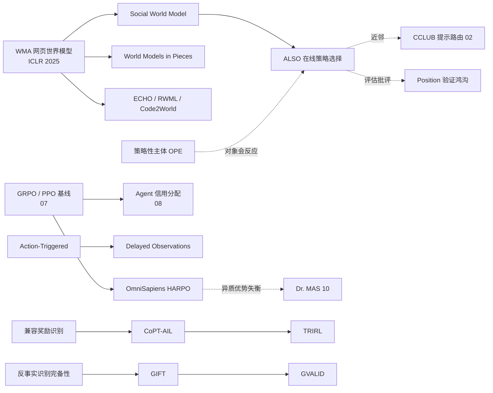

# 01|总览:预备知识、论文地图、发展脉络与阅读路线

> 这是整套阅读材料的**入口**。如果你只想先读一份,就读这份;它告诉你每份文档讲什么、应该按什么顺序读、这些论文之间是什么关系。
> **文档索引**(每篇论文在哪份文档里)见 `00_索引.md`。

## 0. 这套材料怎么来的(方法与诚实声明)

- **来源**:`2026_ICML_ICLR_NeurIPS_策略优化论文目录.xlsx` 中的 **395 篇**(ICML 132 / ICLR 130 / NeurIPS 133,均为 2026),外加你点名的 11 篇 ICML 论文和 1 篇 ICLR 2025(WMA)。
- **官方来源与下载**:
  - **ICML 2026**:PMLR 官方论文集(`proceedings.mlr.press/v306`)。**143 篇 PDF 已下载**到 `papers/ICML2026/`(含你点名的 11 篇)。
  - **ICLR 2025(WMA)**:ICLR 官方论文集,已下载到 `papers/ICLR2025/`。
  - **ICLR 2026 / NeurIPS 2026**:PDF 托管在 OpenReview,**脚本请求会被其验证挑战拦截(HTTP 403)**。我没有绕过,所以这 263 篇只保存了**官网(iclr.cc / neurips.cc)的摘要页链接与 OpenReview 链接**。需要全文请自行用浏览器下载。
- **请求节奏**:单线程串行、每次间隔 4–7 秒、带缓存与断点续传、遇 403/429 即停。全程没有触发限流。
- **怎么读 PDF**:本机没有 PDF 工具(Read 工具依赖的 `pdftoppm` 也没有)。我把纯 Python 的 `pypdf` 库(来自 PyPI)下载到临时目录当本地模块用,把 143 篇 ICML PDF 转成文本再读;**没有安装到系统**。公式部分可能因 PDF 排版出现乱码,我读到的公式以论文原意为准重新写成 LaTeX。
- **阅读深度分三档**(每份文档里的论文都带有标注):

| 档位 | 论文 | 我做了什么 |
|---|---|---|
| **深读(精读)** | 你点名的 17 篇:ALSO、OmniSapiens、Social World Model、WMA、Position、因果识别、Minimax 干预、GIFT、OPE 策略性主体、PEQ-Net、GVALID、在线兼容奖励、CoPT-AIL、TRIRL、Action-Triggered、World Models in Pieces、Delayed Observations;另有"人 vs LLM"(读了方法与主要结果) | 读了全文的设定、方法、定理陈述与实验;**附录里的证明没有逐条核对** |
| **速读** | 其余约 125 篇 ICML 论文 | 读了本地 PDF 的**引言、贡献陈述与结论**,据此写描述;描述末尾标〔速读〕。**没有逐篇核对方法细节与实验表** |
| **摘要级** | ICLR 2026 与 NeurIPS 2026 的 263 篇 | 因 PDF 无法脚本下载,只依据官方摘要写一两句,不超出摘要 |

> 速读与摘要级的概括可能漏掉关键细节。ICML 的 PDF 与对应文本都在本地,**想深入就直接读 PDF**;ICLR / NeurIPS 的 PDF 请手动下载后告诉我,我可以补读。

## 1. 文档地图

| 文档 | 主题 | 适合谁 / 什么时候读 |
|---|---|---|
| `02_社会智能体与社会模拟` | **你最关心的:社会情境中的策略方法**(ALSO、OmniSapiens、Social World Model……) | **最先读** |
| `03_世界模型_因果与干预决策` | 世界模型(WMA)与因果 / 干预决策理论 | 想理解"预测后果" |
| `04_RL与在线学习理论` | 遗憾界、观测受限、老虎机 | 想练习读理论论文 |
| `05_偏好优化与RLHF对齐` | DPO 家族与偏好学习 | 想理解对齐 |
| `06_奖励_偏好RL_逆RL与模仿` | 奖励识别、IRL、奖励模型 | 想理解"奖励从哪来" |
| `07_LLM策略优化算法` | GRPO / PPO 的诊断与改进 | 想理解当前主流算法 |
| `08_LLM_Agent长时程RL与信用分配` | 多轮、工具、记忆、信用分配 | 想做 Agent |
| `09_协作型多智能体强化学习MARL` | 传统 MARL | 想理解多智能体 |
| `10_LLM多智能体_博弈_自博弈与红队` | LLM 多智能体与自博弈 | 想理解自博弈 |
| `11_优化器_训练配方与杂项` | 训练旋钮与跨学科 | 想动手训练时查阅 |
| `12_开源与环境配置清单` | 开源仓库、硬件与软件配置 | 想复现时查阅 |

## 2. 给初学者的预备知识

### 给初学者的 5 分钟预备知识

读后面的论文只需要这 5 个概念。

**(1) 策略(policy)与策略梯度。** 策略 $\pi_\theta(a\mid s)$ 是"在状态 $s$ 下选动作 $a$ 的概率"。策略梯度定理给出更新方向:

$$\nabla_\theta J(\theta)=\mathbb{E}\big[A^{\pi_\theta}(s,a)\,\nabla_\theta\log\pi_\theta(a\mid s)\big]$$

其中**优势** $A$ 表示"这个动作比平均水平好多少"。大模型时代常用的 GRPO 就是把同一个问题采样一组回答,用组内均值和标准差归一化奖励,得到优势:

$$\hat A_i=\frac{r_i-\mu_G}{\sigma_G+\varepsilon}$$

**(2) 多臂老虎机与遗憾(regret)。** 有 $K$ 个选项(臂),每轮选一个、只看到被选中那个的奖励。目标是最小化相对"事后最优固定选项"的损失:

$$\bar R_T=\mathbb{E}\Big[\max_k\sum_t r_k^{(t)}-\sum_t r_{k_t}^{(t)}\Big]$$

*随机*老虎机假设每个臂的奖励分布固定;*对抗*老虎机(EXP3 算法)不做这个假设,允许环境"和你对着干"。这是 ALSO 的理论出发点。

**(3) 世界模型(world model)。** 学一个"如果我这样做,环境会怎样变"的预测器 $s_{t+1}\sim P_\theta(\cdot\mid s_t,a_t)$,先在脑子里推演,再行动。

**(4) 奖励学习:RLHF、逆强化学习(IRL)、模仿学习。** 奖励要么人写,要么从偏好(RLHF)或专家示范(IRL / 对抗模仿)里学出来。

**(5) 因果与离策略评估(OPE)。** 只有历史数据、没法真做实验时,怎么估"新策略如果上线会怎样"。核心工具是**双重稳健(doubly robust)估计**:结果模型和倾向模型*只要有一个对*,估计就是一致的。


## 3. 你点名的 18 篇优先论文:在哪份文档、读到什么深度

| 论文 | 会议 | 所在文档 | 深度 |
|---|---|---|---|
| ALSO | ICML 2026 | `02` | 深读 |
| Web Agents with World Models(WMA) | ICLR 2025 | `03` | 深读 |
| OmniSapiens(HARPO) | ICML 2026 | `02` | 深读 |
| Building Social World Models | ICML 2026 | `02` | 深读 |
| Discovering Differences in Strategic Behavior | ICML 2026 | `02` | 深读(方法与主要结果) |
| Position: Validation Gap | ICML 2026 | `02` | 深读 |
| Causal Identification from Counterfactual Data | ICML 2026 | `03` | 深读 |
| Minimax Approach for Intervention Policy | ICML 2026 | `03` | 深读 |
| GIFT(Target-Driven Policy Optimization) | ICML 2026 | `03` | 深读 |
| OPE with Strategic Agents | ICML 2026 | `03` | 深读 |
| Smooth Multi-Policy / PEQ-Net | ICML 2026 | `03` | 深读 |
| GVALID(Active Policy Optimization for Dosing) | ICML 2026 | `03` | 深读 |
| Online Compatible Reward Identification | ICML 2026 | `06` | 深读 |
| CoPT-AIL | ICML 2026 | `06` | 深读 |
| TRIRL | ICML 2026 | `06` | 深读 |
| Action-Triggered Observations | ICML 2026 | `04` | 深读 |
| World Models in Pieces | ICML 2026 | `04` | 深读 |
| Delayed Observations | ICML 2026 | `04` | 深读 |


## 4. 发展脉络:这些论文如何接起来

### 4.1 五条主线

**主线 1|策略优化:从"改参数"走向"改上下文 / 在线选择"**
```
经典 RL(梯度更新参数) → GRPO / PPO 的诊断与修补(07) → 异质样本的优势平衡 HARPO(02)
                                              ↘ 不改参数:ALSO(02)、CCLUB(02)、WMA(03)
```
共同点:大模型越来越贵、越来越闭源,**优化对象从权重转向"如何调用它"**。

**主线 2|世界模型:从网页 / 物理走向社会,再走向"可认证"**
```
WMA(03,预测"变化"、推理时规划) → Code2World / RWML / ECHO(03,预测什么、怎么训)
                                → Social World Model(02,社会信念 + 隐事件归因)
                                → World Models in Pieces(04,只认证世界模型的"某些片段")
```

**主线 3|奖励不再是给定的**
```
偏好:DPO 家族(05) → 非传递 / 列表 / 博弈
示范:TRIRL、CoPT-AIL(06)
奖励模型:标量 → 可推理的评审、清单、过程奖励(06)
```

**主线 4|对象会反应、数据会缺失**
```
对象会反应:ALSO、CCLUB(02)、策略性主体 OPE、策略性因果政策学习(03)、多智能体非平稳(09、10)
数据会缺失:Action-Triggered、Delayed Observations(04)、反事实识别(03)
```

**主线 5|评估与可信**
```
Position(验证鸿沟)、人 vs LLM、KAIROS、MindGames(02);
Detecting Data Contamination(07);Are Easier or Harder Examples(05)
```

### 4.2 一张关系图



### 4.3 从 Excel 的 395 篇看趋势(按标题关键词的粗略统计)

| 关键词(标题含) | 篇数 | 提示 |
|---|---|---|
| LLM / language model | 191(约 48%) | 策略优化已**以 LLM 为主战场** |
| agent | 155 | |
| multi-agent | 91 | 博弈与多智能体占比高 |
| preference / reward / RLHF | 78 | 奖励学习是持续热点 |
| reasoning | 60(ICLR 31,居首) | ICLR 更偏推理类 RL |
| GRPO / PPO / policy optimization | 53 | |
| social / persona / negotiation / human | 37(NeurIPS 16,居首) | 社会情境仍是少数,但在增长 |
| world model | 28(NeurIPS 13、ICML 11、ICLR 4) | 世界模型数量逐届递增 |
| offline | 9 | |

*标题字符串匹配,同一篇可计入多类,仅供观察方向。*

**我从中读出的三点(判断,非定论)**

1. 论文几乎都围绕"**怎样让 LLM Agent 的决策更好**";传统纯 RL 理论(`04`、`09` 中的一部分)仍有,但是少数派。
2. "社会 + 世界模型 + 在线适应"组合是新兴点,ALSO 与 SWM 都在这个交叉处。
3. 方法分化:一边是**基于梯度的 RL(GRPO 系列)**,一边是**不改权重的推理时方法(搜索、bandit、世界模型规划)**。

### 4.4 理论创新 vs 工程创新:一眼对比(优先论文)

| 论文 | 理论创新 | 工程创新 |
|---|---|---|
| ALSO | 非平稳 → 对抗 bandit 的**建模**(无遗憾界) | 冻结 LLM + 轻量替代网络 |
| WMA | 几乎无 | 差分式观测抽象、推理期规划 |
| HARPO | 几何平均不变性、优势尺度平衡 | VERL 上的多模态多任务 RL |
| SWM | 隐事件归因 + 蒸馏式 ELBO(承认界松) | 双模型解耦、SWM-Bench |
| 人 vs LLM | 程序空间上的双层优化 | AlphaEvolve 驱动的行为建模 |
| 因果识别 | **完备性、识别极限、识别-可实现对偶** | 无 |
| TRIRL | 信任域最优 = 更小步长全局最优 | MuJoCo XLA 并行 |
| CoPT-AIL | 奖励塑形不变性 → 预训练收益的保证 | 单次 BC 联合预训练 |
| Delayed / ATST / WMiP | 紧的遗憾界、动作序列表示、结构认证 | 无(纯理论) |
| OPE 策略性主体 | 局部披露 + 双重稳健一致性 | 合成与德国信用数据实验 |

## 5. 给初学者的阅读路线(建议 4 周)

1. **第 1 周**:读本页 §2–§3 + `03` 的 WMA(最容易)+ `02` 的 Social World Model。目标:建立"世界模型 / 社会信念"的概念。
2. **第 2 周**:读 `02` 的 ALSO + CCLUB。**动手**:先弄懂 EXP3 的 5 行伪代码,再对照 ALSO 的式 (11)–(13),找出两者差别。
3. **第 3 周**:读 `02` 的 OmniSapiens + `07` 的 *GRPO's Loss, Dynamics*。**动手**:用 $2\sqrt{p(1-p)}$ 自己推一遍(见 `02`),思考什么时候几何平均归一不合适。
4. **第 4 周起(选读理论)**:`04` 的 Delayed Observations 或 `06` 的 CoPT-AIL。它们的"一个核心结论"最清楚。
5. **始终带着一个问题**:这篇论文的"保证"是**定理**、**经验现象**,还是**启发式设计**?

## 6. 局限性声明

- ICLR / NeurIPS 的 263 篇只有摘要级概括,且是我对官方摘要的转述;ICML 的约 125 篇非优先论文只是速读(引言+贡献+结论)。**两者都可能漏掉关键细节**。
- 对 ALSO 的"启发式、非 EXP3 无偏估计"判断,是我对式 (12)–(13) 与经典 EXP3 的比较,**属于笔者推断**;作者明确说的是"未声称正式遗憾保证"。
- 论文表中的"领域"标签是粗分类,我重新按内容分了组,个别论文的归属有主观成分。
- "给初学者的可带走认识"带有主观取舍,请当作阅读入口,而不是结论。
- OmniSapiens 与 Social World Model 的数字在 arXiv 与 ICML 页面之间不一致,已在 `02` 中标注。
